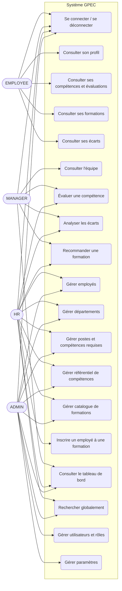

# Phase 3 — Cas d'utilisation

## 1. Diagramme de cas d'utilisation

Mermaid ne propose pas de diagramme UML de cas d'utilisation natif ; il est représenté en `flowchart`
(acteurs à gauche, cas d'utilisation dans la frontière du système). Les rôles héritent les uns des autres
selon la hiérarchie : ADMIN ⊃ HR ⊃ MANAGER ⊃ EMPLOYEE pour la consultation de ses propres données.

## 2. Matrice acteurs × cas d'utilisation

| Cas d'utilisation | EMPLOYEE | MANAGER | HR | ADMIN |
|---|:-:|:-:|:-:|:-:|
| UC1 Se connecter / se déconnecter | ✔ | ✔ | ✔ | ✔ |
| UC2 Consulter son profil | ✔ | ✔ | ✔ | ✔ |
| UC3 Consulter ses compétences et évaluations | ✔ | ✔ | ✔ | ✔ |
| UC4 Consulter ses formations | ✔ | ✔ | ✔ | ✔ |
| UC5 Consulter ses écarts | ✔ | ✔ | ✔ | ✔ |
| UC6 Consulter l'équipe | | ✔ (son équipe) | ✔ (tous) | ✔ (tous) |
| UC7 Évaluer une compétence | | ✔ (son équipe) | ✔ | |
| UC8 Analyser les écarts | | ✔ (son équipe) | ✔ | ✔ |
| UC9 Recommander une formation | | ✔ | ✔ | |
| UC10 Gérer employés | | | ✔ | ✔ |
| UC11 Gérer départements | | | ✔ | ✔ |
| UC12 Gérer postes et compétences requises | | | ✔ | ✔ |
| UC13 Gérer référentiel de compétences | | | ✔ | ✔ |
| UC14 Gérer catalogue de formations | | | ✔ | ✔ |
| UC15 Inscrire un employé à une formation | | | ✔ | ✔ |
| UC16 Consulter le tableau de bord | | ✔ (équipe) | ✔ | ✔ |
| UC17 Rechercher globalement | | | ✔ | ✔ |
| UC18 Gérer utilisateurs et rôles | | | | ✔ |
| UC19 Gérer paramètres | | | | ✔ |

> L'ADMIN dispose des mêmes droits de gestion que HR (cahier des charges : « gestion complète »).
> Il n'évalue pas les compétences par défaut : l'évaluation reste un acte RH/manager.
> Décision d'implémentation à confirmer en Phase 8 (RBAC).

## 3. Scénarios principaux

### UC1 — Se connecter
- **Acteur** : tout utilisateur. **Pré-condition** : compte actif.
- **Nominal** : saisie email + mot de passe → l'API vérifie le hash Argon2 → retourne access token et refresh token → redirection vers le tableau de bord.
- **Alternatifs** : identifiants invalides → 401 sans préciser lequel est faux ; compte désactivé → 403.
- **Post-condition** : session ouverte ; le refresh token est stocké haché.

### UC7 — Évaluer une compétence
- **Acteur** : MANAGER (son équipe) ou HR. **Pré-condition** : employé et compétence existent.
- **Nominal** : sélection de l'employé et de la compétence → saisie du niveau (1..niveau max), du commentaire → création d'une `SkillEvaluation` (date, évaluateur) → mise à jour du niveau courant dans `EmployeeSkill`.
- **Alternatifs** : niveau hors bornes → 400 ; employé hors équipe du manager → 403 ; employé ou compétence introuvable → 404.
- **Post-condition** : historique enrichi, jamais écrasé (R4).

### UC8 — Analyser les écarts
- **Acteur** : MANAGER, HR, ADMIN ; l'EMPLOYEE voit les siens (UC5).
- **Pré-condition** : l'employé a un poste avec des compétences requises.
- **Nominal** : sélection d'un employé → le système compare le niveau requis (`PositionSkill`) au niveau actuel (`EmployeeSkill`) → affiche compétence, actuel, requis, écart, priorité, formation recommandée.
- **Alternatifs** : poste sans compétence requise → liste vide ; compétence jamais évaluée → niveau actuel = 0 ; employé sans poste → 409.
- **Règles** : R1, R2.

### UC9 — Recommander une formation
- **Acteur** : MANAGER, HR. **Pré-condition** : au moins un écart > 0.
- **Nominal** : pour chaque compétence déficitaire, le système propose les formations ciblant la compétence, de niveau > niveau actuel, la plus proche du niveau requis d'abord → l'utilisateur confirme une recommandation / inscription (UC15).
- **Alternatifs** : aucune formation adaptée → message explicite ; formation complète ou déjà suivie → exclue (R5).

### UC10 — Gérer employés
- **Acteur** : HR, ADMIN.
- **Nominal** : créer / modifier / consulter / rechercher / supprimer un employé.
- **Alternatifs** : matricule ou email déjà utilisé → 409 ; manager = lui-même → 400 (R6) ; suppression → logique (R7).

### UC15 — Inscrire un employé à une formation
- **Acteur** : HR, ADMIN.
- **Nominal** : choix employé + formation → création d'une `EmployeeTraining` (statut inscrit) → suivi du statut.
- **Alternatifs** : capacité atteinte → 409 ; déjà inscrit → 409.

## 4. Traçabilité exigences → cas d'utilisation

| Exigence | Cas d'utilisation |
|---|---|
| F-AUTH-1..3 | UC1, UC18 |
| F-EMP-1..3 | UC2, UC3, UC4, UC6, UC10 |
| F-DEP-1 | UC11 |
| F-POS-1..2 | UC12 |
| F-SKL-1 | UC13 |
| F-EVA-1..2 | UC7, UC3 |
| F-GAP-1 | UC5, UC8 |
| F-TRN-1..3 | UC9, UC14, UC15 |
| F-DSH-1..2 | UC16 |
| F-SRCH-1 | UC17 |
