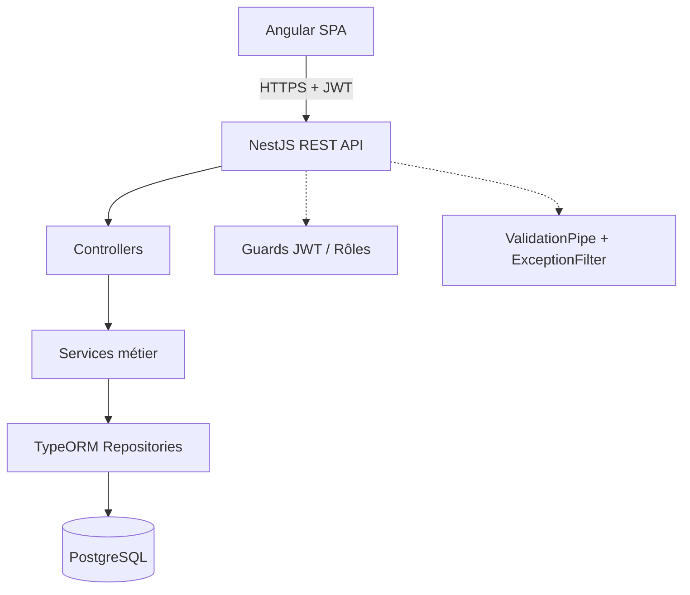
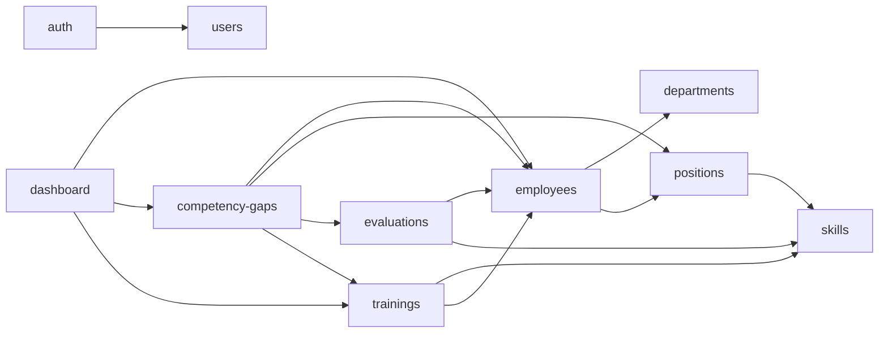
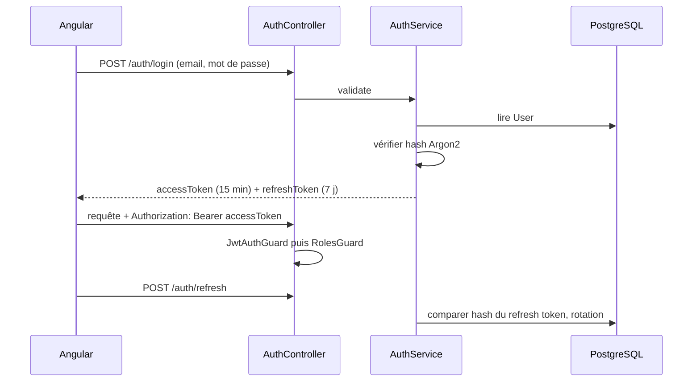

# Phase 4 — Architecture

## 1. Vue d'ensemble



- Frontend et backend sont séparés et communiquent uniquement par API REST.
- Contrôleurs : routage, DTO, codes HTTP. Aucune logique métier.
- Services : règles métier (R1 à R8), calcul des écarts, recommandations.
- Repositories TypeORM : accès aux données, requêtes paginées.

## 2. Structure du dépôt

```
Application GPEC/
├── backend/            # NestJS
├── frontend/           # Angular
├── docs/               # analyse, UML, architecture
├── docker-compose.yml  # PostgreSQL (+ pgAdmin optionnel)
├── .env.example
└── README.md
```

## 3. Backend (NestJS)

```
backend/src/
├── main.ts                 # bootstrap, Swagger, CORS, ValidationPipe, préfixe /api
├── app.module.ts
├── config/                 # configuration typée + validation des variables d'environnement
├── database/
│   ├── data-source.ts      # DataSource TypeORM (CLI migrations)
│   ├── migrations/
│   └── seeds/              # rôles, compétences, admin initial
├── common/
│   ├── decorators/         # @Roles(), @CurrentUser()
│   ├── filters/            # AllExceptionsFilter
│   ├── dto/                # PaginationQueryDto, PageResponse
│   ├── enums/              # Role, TrainingStatus, Priority
│   └── interceptors/       # sérialisation (masque les champs sensibles)
├── auth/                   # login, register (ADMIN), refresh, logout, me
├── users/                  # comptes et rôles
├── employees/
├── departments/
├── positions/              # + PositionSkill
├── skills/
├── evaluations/            # SkillEvaluation + mise à jour EmployeeSkill
├── trainings/              # + EmployeeTraining
├── competency-gaps/        # calcul des écarts + recommandations
└── dashboard/              # agrégations
```

Chaque module : `*.module.ts`, `*.controller.ts`, `*.service.ts`, `entities/`, `dto/`, `*.spec.ts`.

### Graphe de dépendances des modules

Règle : pas de dépendance circulaire. `competency-gaps` et `dashboard` sont en lecture seule sur les autres modules.

## 4. Authentification et autorisation



- Access token court (15 min), refresh token (7 j) stocké **haché** en base et renouvelé à chaque usage (rotation). `/auth/logout` l'invalide.
- `JwtAuthGuard` global ; les routes publiques sont marquées `@Public()` (login, refresh).
- `RolesGuard` + `@Roles(...)` pour le RBAC par route.
- Contrôle de périmètre dans les services : un MANAGER n'accède qu'à son équipe, un EMPLOYEE qu'à lui-même.
- Côté Angular, le refresh token est géré par l'intercepteur ; le stockage et la durée seront précisés en Phase 8.

## 5. Données
- Migrations TypeORM versionnées ; `synchronize` désactivé.
- Suppression logique des employés (`deletedAt`).
- Index sur clés étrangères, matricule, email, noms recherchés.
- Pagination `?page&limit&search` via `PaginationQueryDto`, réponse `{ data, total, page, limit }`.

## 6. Configuration et secrets
Variables dans `.env` (jamais commité) ; modèle dans `.env.example` :
`PORT`, `NODE_ENV`, `DATABASE_HOST`, `DATABASE_PORT`, `DATABASE_USER`, `DATABASE_PASSWORD`, `DATABASE_NAME`,
`JWT_ACCESS_SECRET`, `JWT_REFRESH_SECRET`, `JWT_ACCESS_TTL`, `JWT_REFRESH_TTL`, `CORS_ORIGIN`.
L'application refuse de démarrer si une variable obligatoire manque.

## 7. Erreurs et validation
- `ValidationPipe` global : `whitelist`, `forbidNonWhitelisted`, `transform`.
- `AllExceptionsFilter` : format unique `{ statusCode, message, error, timestamp, path }` ; aucun détail interne en production.
- Mapping : doublon unique → 409, entité absente → 404, rôle insuffisant → 403, token invalide → 401.

## 8. Frontend (Angular standalone)

```
frontend/src/app/
├── core/
│   ├── guards/         # authGuard, roleGuard
│   ├── interceptors/   # authInterceptor (Bearer + refresh), errorInterceptor
│   ├── services/       # AuthService, ApiService
│   └── models/
├── shared/
│   ├── components/     # tableau paginé, barre de recherche, modale de confirmation, badge de niveau
│   ├── directives/     # *hasRole
│   └── pipes/
├── features/           # auth, dashboard, employees, departments, positions,
│                       # skills, evaluations, trainings, gaps  (routes en lazy loading)
└── app.routes.ts
```
- Reactive Forms, `HttpClient`, un service par ressource, composants courts et réutilisables.
- Chaque feature expose ses routes et est chargée à la demande.
- Graphiques : Chart.js via ng2-charts.

## 9. Infrastructure locale
`docker-compose.yml` lance PostgreSQL avec volume persistant et variables issues de `.env`. Le backend et le frontend tournent en local (`npm run start:dev`, `ng serve`). Un Dockerfile par application sera ajouté en Phase 17.

## 10. Stratégie de tests
| Niveau | Outil | Cible prioritaire |
|---|---|---|
| Unitaire backend | Jest | AuthService, calcul des écarts, recommandations, RolesGuard |
| Intégration backend | Jest + Testcontainers ou base de test | CRUD employés/compétences, contraintes uniques |
| API (e2e) | Supertest | login, permissions par rôle, pagination |
| Unitaire frontend | Jasmine/Karma ou Jest | services, guards, composants clés |

## 11. Décisions d'architecture (ADR courts)
| Décision | Raison |
|---|---|
| Monorepo sans outil de workspace | Simplicité, deux projets indépendants |
| Argon2 | Standard actuel de hachage de mots de passe |
| Refresh token haché + rotation | Logout réellement effectif |
| Migrations plutôt que `synchronize` | Évolution de schéma maîtrisée |
| Guard JWT global + `@Public()` | Sécurisé par défaut, évite l'oubli de protection |
| Contrôle de périmètre dans les services | Le rôle seul ne protège pas les données d'une autre équipe |
