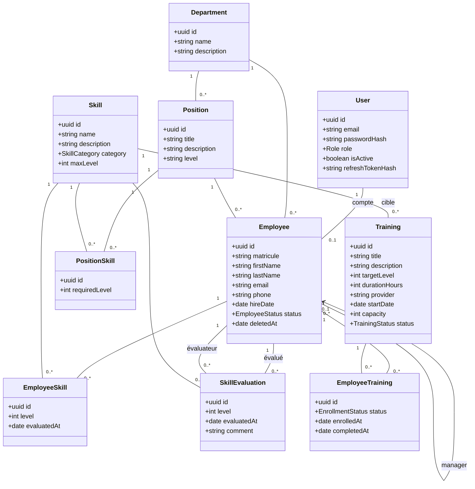
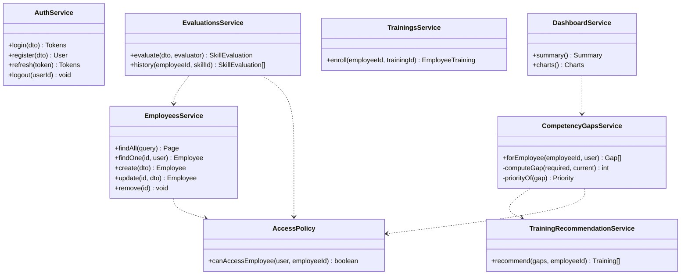
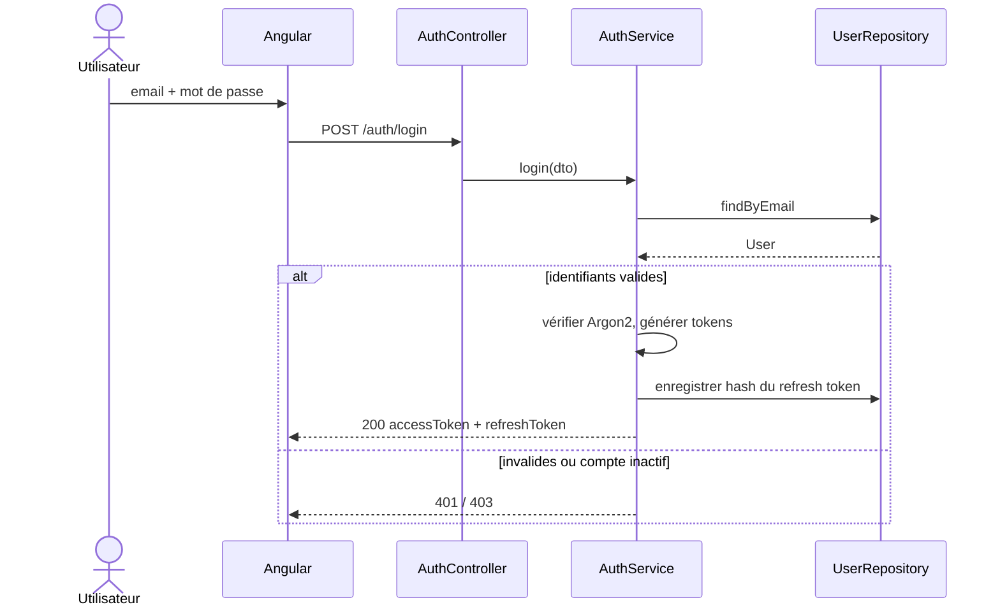
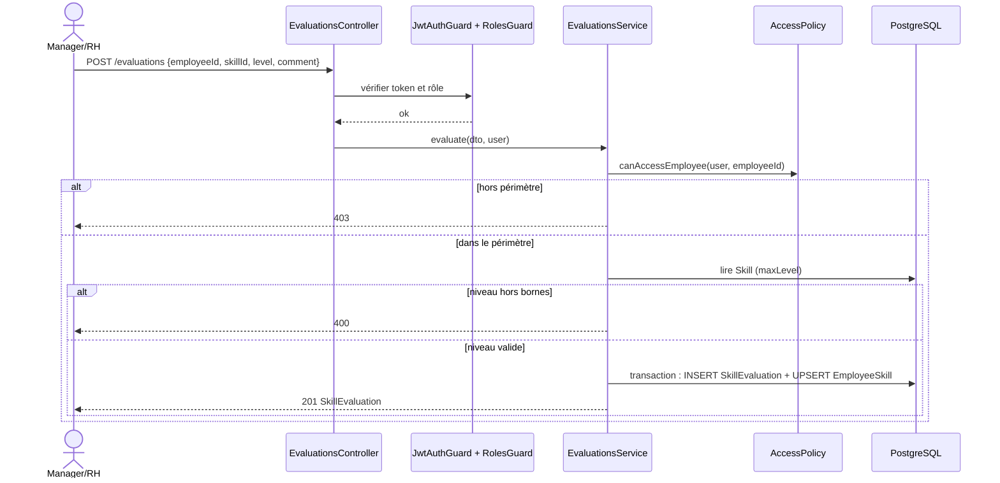
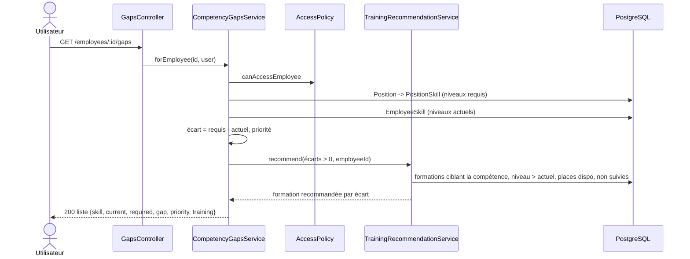
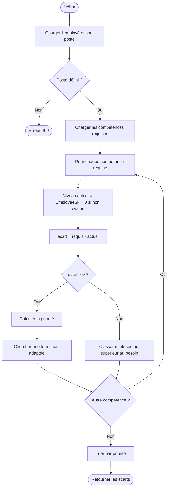
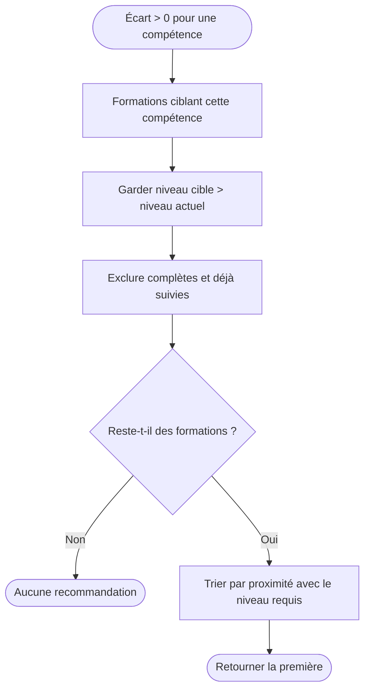
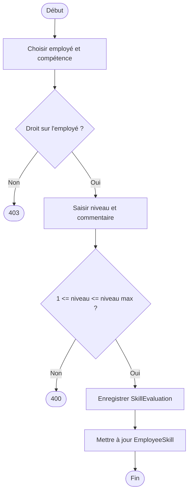

# Phase 5 — UML

Les diagrammes de cas d'utilisation sont dans `03-cas-d-utilisation.md` et le diagramme d'architecture dans
`04-architecture.md`. Les noms de classes correspondent aux entités TypeORM et aux services NestJS prévus ;
ils seront revérifiés à la fin du développement (Phase 16).

## 1. Diagramme de classes (entités)

Contraintes : unicité de (`Employee`, `Skill`) dans `EmployeeSkill`, de (`Position`, `Skill`) dans `PositionSkill`
et de (`Employee`, `Training`) dans `EmployeeTraining`. `Employee.matricule` et `Employee.email` sont uniques.

## 2. Classes de services (couche métier)

`AccessPolicy` centralise le contrôle de périmètre (MANAGER : son équipe, EMPLOYEE : lui-même) pour éviter de le
dupliquer dans chaque service.

## 3. Diagrammes de séquence

### 3.1 Connexion

### 3.2 Évaluation d'une compétence

### 3.3 Calcul des écarts et recommandation

## 4. Diagrammes d'activité

### 4.1 Analyse des écarts d'un employé

### 4.2 Recommandation d'une formation

### 4.3 Cycle de vie d'une évaluation

## 5. Modèle conceptuel de données
Le MCD/ER détaillé (clés, types, index) est produit en Phase 6.

## 6. Points de conception retenus
- Les écarts sont **calculés à la demande** et non stockés, pour toujours refléter la dernière évaluation.
- `User` est séparé d'`Employee` : un compte peut exister sans fiche employé (ADMIN technique).
- `Position` appartient à un `Department` (cahier des charges, §8).
- Deux relations distinctes entre `Employee` et `SkillEvaluation` : l'employé évalué et l'évaluateur.
