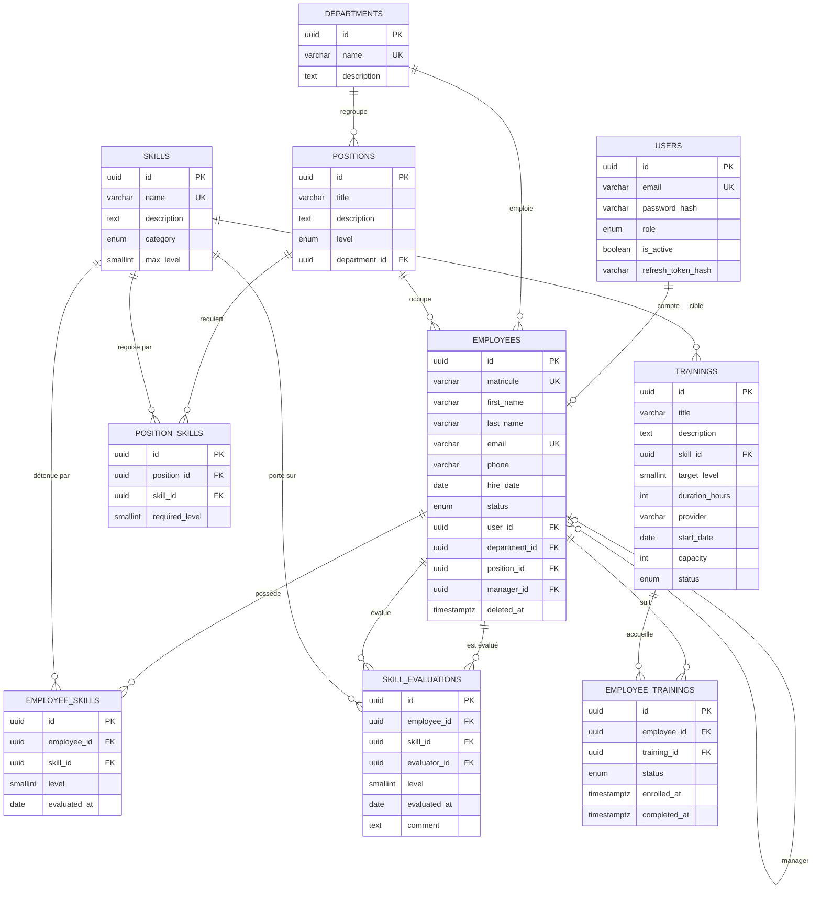

# Phase 6 — Modèle de données

SGBD : PostgreSQL. ORM : TypeORM (migrations, pas de `synchronize`).
Conventions : tables au pluriel en `snake_case`, clés primaires `uuid` (`gen_random_uuid()`), colonnes
`created_at` / `updated_at` sur toutes les tables, noms de colonnes en `snake_case`.

## 1. Diagramme entité-relation

## 2. Dictionnaire de données

### users
| Colonne | Type | Contraintes |
|---|---|---|
| id | uuid | PK |
| email | varchar(255) | NOT NULL, UNIQUE |
| password_hash | varchar(255) | NOT NULL (Argon2) |
| role | enum `user_role` | NOT NULL |
| is_active | boolean | NOT NULL, défaut `true` |
| refresh_token_hash | varchar(255) | NULL |

### employees
| Colonne | Type | Contraintes |
|---|---|---|
| id | uuid | PK |
| matricule | varchar(30) | NOT NULL, UNIQUE |
| first_name, last_name | varchar(100) | NOT NULL |
| email | varchar(255) | NOT NULL, UNIQUE |
| phone | varchar(30) | NULL |
| hire_date | date | NOT NULL |
| status | enum `employee_status` | NOT NULL, défaut `ACTIVE` |
| user_id | uuid | FK users, UNIQUE, NULL |
| department_id | uuid | FK departments, NOT NULL |
| position_id | uuid | FK positions, NULL |
| manager_id | uuid | FK employees, NULL, CHECK `manager_id <> id` |
| deleted_at | timestamptz | NULL (suppression logique) |

### departments
| Colonne | Type | Contraintes |
|---|---|---|
| id | uuid | PK |
| name | varchar(100) | NOT NULL, UNIQUE |
| description | text | NULL |

### positions
| Colonne | Type | Contraintes |
|---|---|---|
| id | uuid | PK |
| title | varchar(150) | NOT NULL |
| description | text | NULL |
| level | enum `position_level` | NOT NULL |
| department_id | uuid | FK departments, NOT NULL |
| | | UNIQUE (`title`, `department_id`) |

### skills
| Colonne | Type | Contraintes |
|---|---|---|
| id | uuid | PK |
| name | varchar(100) | NOT NULL, UNIQUE |
| description | text | NULL |
| category | enum `skill_category` | NOT NULL |
| max_level | smallint | NOT NULL, défaut 5, CHECK 1..10 |

### position_skills
| Colonne | Type | Contraintes |
|---|---|---|
| position_id | uuid | FK positions, NOT NULL, ON DELETE CASCADE |
| skill_id | uuid | FK skills, NOT NULL, ON DELETE RESTRICT |
| required_level | smallint | NOT NULL, CHECK `>= 1` |
| | | UNIQUE (`position_id`, `skill_id`) (R8) |

### employee_skills (niveau courant)
| Colonne | Type | Contraintes |
|---|---|---|
| employee_id | uuid | FK employees, NOT NULL |
| skill_id | uuid | FK skills, NOT NULL |
| level | smallint | NOT NULL, CHECK `>= 1` |
| evaluated_at | date | NOT NULL |
| | | UNIQUE (`employee_id`, `skill_id`) |

### skill_evaluations (historique, jamais modifié)
| Colonne | Type | Contraintes |
|---|---|---|
| employee_id | uuid | FK employees, NOT NULL |
| skill_id | uuid | FK skills, NOT NULL |
| evaluator_id | uuid | FK employees, NOT NULL |
| level | smallint | NOT NULL, CHECK `>= 1` |
| evaluated_at | date | NOT NULL |
| comment | text | NULL |

### trainings
| Colonne | Type | Contraintes |
|---|---|---|
| title | varchar(200) | NOT NULL |
| description | text | NULL |
| skill_id | uuid | FK skills, NOT NULL |
| target_level | smallint | NOT NULL, CHECK `>= 1` |
| duration_hours | int | NOT NULL, CHECK `> 0` |
| provider | varchar(150) | NULL |
| start_date | date | NULL |
| capacity | int | NOT NULL, CHECK `> 0` |
| status | enum `training_status` | NOT NULL, défaut `PLANNED` |

### employee_trainings
| Colonne | Type | Contraintes |
|---|---|---|
| employee_id | uuid | FK employees, NOT NULL |
| training_id | uuid | FK trainings, NOT NULL |
| status | enum `enrollment_status` | NOT NULL, défaut `ENROLLED` |
| enrolled_at | timestamptz | NOT NULL, défaut `now()` |
| completed_at | timestamptz | NULL |
| | | UNIQUE (`employee_id`, `training_id`) |

## 3. Énumérations
| Enum | Valeurs |
|---|---|
| `user_role` | ADMIN, HR, MANAGER, EMPLOYEE |
| `employee_status` | ACTIVE, ON_LEAVE, INACTIVE |
| `position_level` | JUNIOR, INTERMEDIATE, SENIOR, LEAD, MANAGER |
| `skill_category` | TECHNICAL, SOFT |
| `training_status` | PLANNED, OPEN, IN_PROGRESS, COMPLETED, CANCELLED |
| `enrollment_status` | ENROLLED, IN_PROGRESS, COMPLETED, CANCELLED |

Le niveau d'une compétence est un entier (1 = Débutant, 2 = Intermédiaire, 3 = Confirmé, 4 = Avancé,
5 = Expert) ; les libellés sont gérés côté applicatif.

## 4. Index
- Clés étrangères : `employees(department_id)`, `employees(position_id)`, `employees(manager_id)`,
  `positions(department_id)`, `trainings(skill_id)`, `skill_evaluations(employee_id, skill_id, evaluated_at DESC)`,
  `employee_trainings(training_id)`.
- Recherche : `employees(last_name, first_name)`, `skills(category)`, `trainings(status)`.
- Les contraintes UNIQUE créent déjà leurs index (matricule, email, paires `employee/skill`, `position/skill`).
- Suppression logique : les index uniques de `employees` sont partiels (`WHERE deleted_at IS NULL`) pour
  permettre de réutiliser un matricule ou un email après suppression.

## 5. Règles d'intégrité non exprimables en SQL
Ces règles sont vérifiées dans les services, avec test unitaire :
- R3 : `level` d'une évaluation ≤ `skills.max_level`.
- `position_skills.required_level` ≤ `skills.max_level`.
- `trainings.target_level` ≤ `skills.max_level`.
- Capacité d'une formation : nombre d'inscrits actifs ≤ `capacity` (409 sinon).
- Un manager doit être un employé actif d'un rôle MANAGER ou HR.

## 6. Écarts avec les phases précédentes
- `Employee.deletedAt` (R7) est une colonne `deleted_at` ; la suppression logique utilise `softDelete` de TypeORM.
- L'évaluateur d'une évaluation référence `employees` (et non `users`) : un compte sans fiche employé ne peut
  pas évaluer, ce qui est cohérent avec le choix de ne pas laisser l'ADMIN évaluer.
- `skills.max_level` est borné à 10 pour rester cohérent avec l'échelle du référentiel ; la valeur par défaut est 5.
